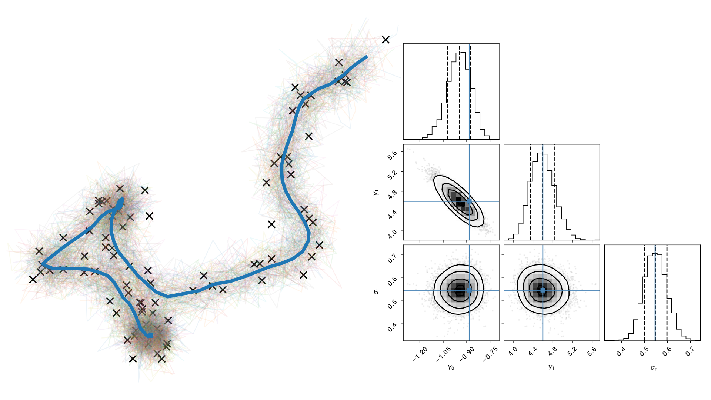

<p align="center">
  
  <br>
      Cell motility inference with Kalman filters and simulation based inference
</p>

## Synthetic killer–target inference framework

The expanded study is now written as a [Nature Communications-style manuscript](manuscript/nature_communications/main.pdf), with [Supplementary Information](manuscript/nature_communications_supplement/main.pdf), 13 refined figures and source data. See the [manuscript guide](manuscript/README.md) for the added simulations, interpretation and reproduction commands.

The new `motility_inference` package tests whether target-associated changes in
active movement amplitude, directional persistence and short-timescale jitter
can be recovered from synthetic tracks. It includes an accelerated ABM,
hierarchical Bayesian state-space inference, neural simulation-based inference,
rejection ABC, and independent validation against the supplied MantiShrimp ABM.
**All included results are synthetic.**

Start with the [results report](results/synthetic_v1/REPORT.md), the
[model and implementation guide](research/INFERENCE_FRAMEWORK.md), or these
executed notebooks:

1. [Simulator and scientific question](notebooks/01_simulator_and_question.ipynb)
2. [Hierarchical state-space inference](notebooks/02_hierarchical_state_space.ipynb)
3. [Simulation-based inference](notebooks/03_simulation_based_inference.ipynb)
4. [Validation and results](notebooks/04_validation_and_results.ipynb)

Install in your preferred isolated environment:

```bash
python -m pip install -e '.[notebooks,test]'
```

Reproduce the full benchmark from the repository root:

```bash
python scripts/run_synthetic_benchmark.py --stage all
python scripts/check_timestep.py
python scripts/render_benchmark_report.py
python scripts/execute_notebooks.py
```

Individual stages (`speed`, `bank`, `train`, `evaluate`, `state-space`,
`reference`, `refine`, `ppc`) can be run separately. The `refine` stage extends
only MCMC runs that failed the numerical quality gate, retaining their earlier
diagnostics. Default benchmark output is `results/synthetic_v1/`.

```bash
PYTEST_DISABLE_PLUGIN_AUTOLOAD=1 python -m pytest -q
```

The plugin-autoload setting avoids unrelated globally installed pytest plugins;
the project requires no external pytest plugin. All notebooks use saved results
when present and do not launch large training jobs by default.

The supplied ABM now has optional `killer_delta_speed`, `killer_delta_tau` and
`killer_delta_jitter` parameters in `MotilityConfig`. Zero defaults preserve its
original dynamics. The faster reduced engine has explicit simplifications; its
speedup is measured against the same reduced model's reference implementation,
not presented as exact equivalence to the full ABM.

The original OU/Kalman and trajectory-embedding workflows are documented below.


## Simulator and OU Motility Model

The simulator generates two-dimensional cell trajectories from a polarity-driven Ornstein-Uhlenbeck (OU) motility model. Each cell has an unobserved polarity-like variable $p(t)$ and an observed position-like variable $x(t)$. In one spatial dimension,

```math
dp(t) = a p(t)\,dt + s_0\,dW_0(t)
```

```math
dx(t) = b p(t)\,dt + s_1\,dW_1(t)
```

where:

* $a < 0$ controls polarity relaxation,
* $b$ controls how strongly polarity drives displacement,
* $s_0$ is the polarity diffusion scale,
* $s_1$ is the positional diffusion scale.

In two dimensions, the same dynamics are applied independently to the $x$- and $y$-axes.

The onset/offset-style simulations use two regimes:

1. **Pre-onset / offset regime:** motion is close to pure stochastic motion. Polarity relaxes rapidly and coupling from polarity to position is weak or zero.
2. **Post-onset regime:** the cell enters a stochastic-plus-driving regime in which polarity persistence and polarity-position coupling generate directed motility.

The transition is smoothed with a sigmoid gate around the supplied onset frame rather than imposed as a hard switch. This gives trajectories that begin as weakly persistent random motion and then acquire a polarity-driven component.

The same generative structure is used by both the analytical Kalman-filter/MCMC workflow and the simulation-based inference workflows.

---

## Analytical Kalman Filter + MCMC Inference

The analytical inference route uses the fact that the OU motility model is linear and Gaussian after exact discretisation. For a sampling interval $\Delta t$, the continuous-time model has the discrete state-space form

```math
z_{k+1} = F_k z_k + \eta_k,
\qquad
\eta_k \sim \mathcal{N}(0, Q_k).
```

Here $F_k$ and $Q_k$ are obtained analytically from the matrix exponential and integrated process-noise covariance.

For a two-dimensional trajectory, the latent state is

```math
z_k =
(p_{x,k}, p_{y,k}, x_k, y_k)^\top,
```

where $(p_{x,k}, p_{y,k})$ are latent polarity variables and $(x_k, y_k)$ are observed cell positions. The observation model is

```math
y_k = H z_k + \epsilon_k,
\qquad
\epsilon_k \sim \mathcal{N}(0, \sigma_{\mathrm{obs}}^2 I_2),
```

with

```math
H =
\begin{pmatrix}
0 & 0 & 1 & 0 \\
0 & 0 & 0 & 1
\end{pmatrix}.
```

The pre/post transition is encoded by making the drift and coupling time-dependent. For trajectory $i$, with onset frame $t_i^\ast$, a sigmoid gate $s_{i,k}$ interpolates between the pre-onset and post-onset regimes. The post-onset relaxation rate is inferred, while the pre-onset relaxation is parameterised as a fixed multiple of the post-onset rate. The coupling is similarly gated so that it is weak before onset and active after onset.

For fixed kinetic parameters, the latent polarity paths do not need to be sampled. They are integrated out exactly with a Kalman filter, producing the marginal trajectory likelihood

```math
p(y_{i,1:T_i} \mid \theta_i).
```

The total log likelihood is the sum over trajectories. Missing or padded frames are handled by skipping the measurement update while retaining state propagation.

Parameter uncertainty is inferred with NumPyro. The Kalman filter supplies the marginal likelihood term, and Hamiltonian Monte Carlo / NUTS samples the posterior over the kinetic parameters. A MAP estimate from deterministic variational optimisation is used to initialise the chain.

The implementation supports:

* a **single-population model**, where all trajectories share one parameter vector;
* a **labelled multi-class model**, where class-specific parameters are inferred with hierarchical priors.

In the multi-class case, each trajectory contributes its own Kalman-filter likelihood under the parameters of its assigned class.

For the differentiable JAX Kalman filtering implementation, see:

https://github.com/dpohanlon/kaljax

---

## Simulation-Based Inference: Representation Learning, ABC, and MDN

The simulation-based inference (SBI) route avoids evaluating the analytical likelihood directly. Instead, it learns a compact representation of simulated trajectories and uses this representation for approximate posterior inference.

Training data are read from HDF5 simulation files. The expected fields include:

* observed tracks,
* masks for padded time points,
* class labels,
* onset indices,
* per-cell or per-class kinetic parameters.

When full unmasked tracks are available, the training scripts can use those directly; otherwise they use the stored masked trajectories.

For the onset model, the target parameter vector is

```math
\theta = (\gamma_0, \gamma_1, \log \sigma_r),
```

with $\sigma_p$ fixed in the current SBI posterior-output convention.

---

### Representation Learning

A Transformer encoder maps each trajectory to a fixed-dimensional embedding. The input consists of the two positional coordinates, optionally augmented with a post-onset indicator channel.

The model is trained so that embeddings capture parameter-relevant variation in the trajectories. Auxiliary heads and losses can encourage:

* class separation,
* parameter prediction,
* onset-aware structure in the learned representation.

The learned embedding is then used as the summary statistic for approximate bayesian computation (ABC), and as the context representation for Gaussian mixture density network (MDN) posterior inference.

---

### ABC Posterior

The ABC workflow uses the trained embedding model as a summary-statistic map.

For observed tracks:

1. compute observed summaries using the trained encoder;
2. draw candidate parameters from the prior;
3. simulate trajectories under those parameters;
4. embed the simulated trajectories with the same encoder;
5. compare simulated and observed summaries.

The sampler uses ABC with sequential Monte Carlo (SMC) rather than simple rejection ABC. A pilot stage sets an initial distance threshold. Successive populations then:

* perturb previously accepted particles,
* resimulate trajectories,
* recompute summaries,
* retain particles whose summary distance is below the current threshold.

Importance weights correct for the proposal distribution.

The final output is a weighted posterior sample over

```math
(\gamma_0, \gamma_1, \log \sigma_r),
```

saved alongside physical-scale samples such as $\gamma_0$, $\gamma_1$, $\sigma_r$, and fixed $\sigma_p$.

---

### MDN Posterior

The MDN workflow amortises posterior inference. It uses the same trajectory encoder, but trains a mixture-density head to predict a conditional density over parameters from a set-level context.

The context is built from embeddings of all selected tracks in a class or dataset subset. It can include summary statistics such as:

* embedding mean,
* embedding standard deviation,
* log number of tracks.

The MDN head represents

```math
q_\phi(\theta \mid \mathrm{context})
```

as a Gaussian mixture with learned mixture weights, component means, and full covariance factors.

At inference time:

1. observed tracks are embedded;
2. a set-level context vector is constructed;
3. posterior samples are drawn directly from the learned mixture;
4. samples are transformed from the normalised training parameter space back to physical parameters;
5. results are written to the same posterior-style HDF5 format used by the other inference routes.
