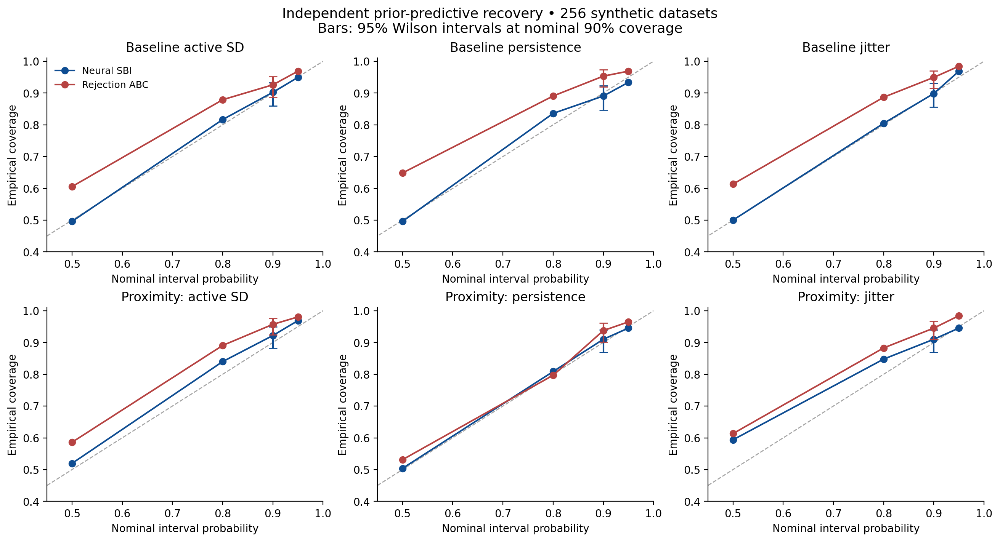
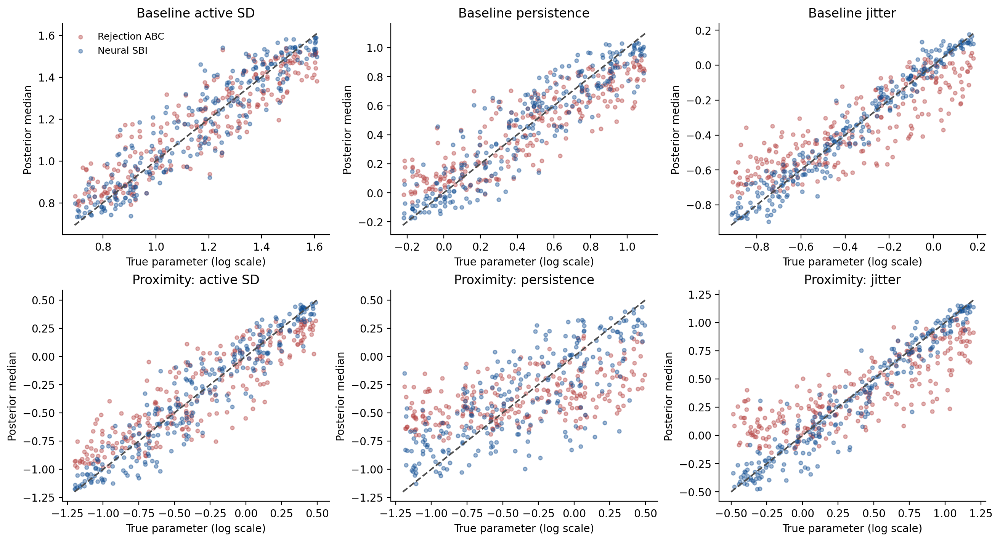
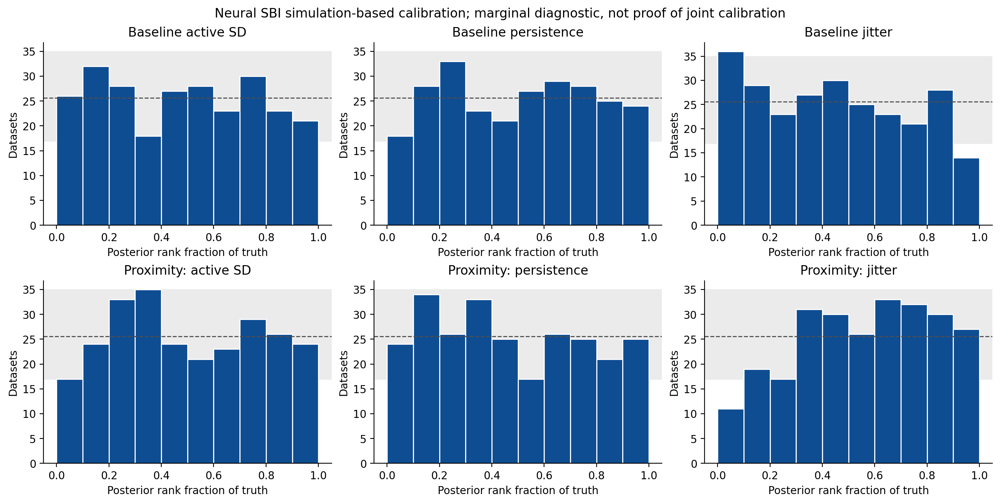
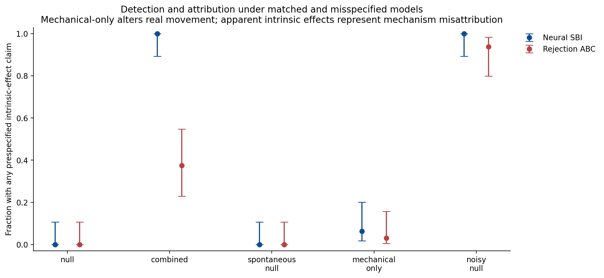
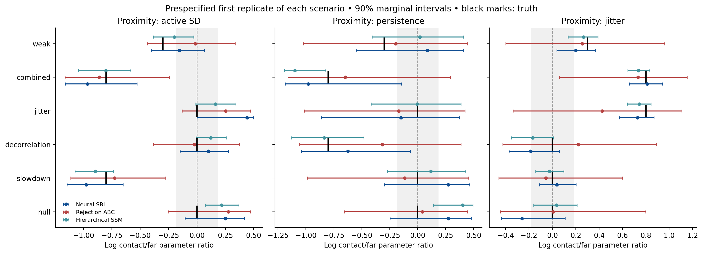
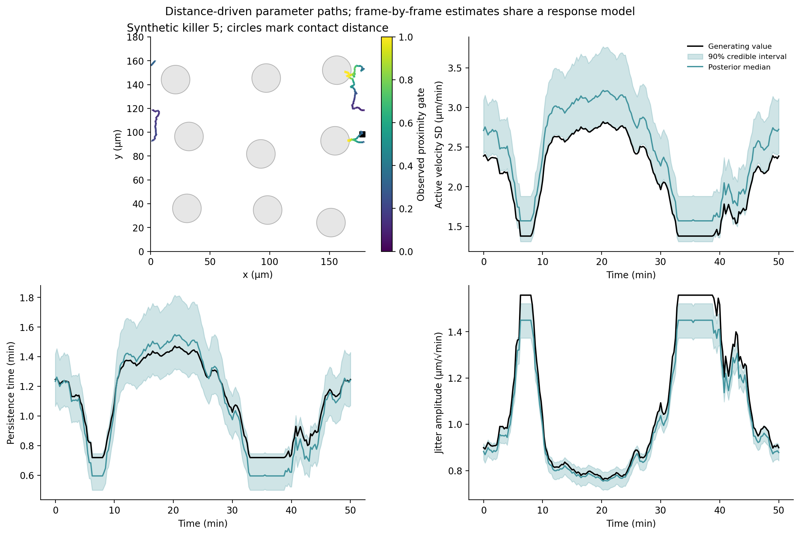

# Synthetic killer–target migration benchmark

**Synthetic validation only. No experimental trajectories were analyzed.**

The benchmark asks whether distance-associated changes in active movement amplitude, persistence and short-timescale jitter can be recovered, and whether omitted mechanisms produce false attribution. It cannot establish whether real killer cells change behavior near targets.

## What the completed tests show

**This is feasible for strong proximity-associated slowdown and jitter under the tested model.** In the combined scenario, neural SBI detected slowdown in 32/32 movies and increased jitter in 32/32. It made no prespecified effect claims in 32 matched null movies; the 95% Wilson upper bound is still 10.7%, so zero observed errors does not imply zero error risk.

The neural posterior's nominal 90% intervals covered the true parameters in 89.1%–92.2% of 256 independent prior-predictive movies. Directional persistence was less identifiable: the neural method detected it in 17/32 persistence-only movies and 3/32 combined movies. A successful any-effect decision therefore does not mean every mechanism was recovered.

**The main limitation is attribution.** Unmodeled localization noise and mechanical sticking can produce apparent intrinsic motility effects. The provided application wrapper rejects declared acquisition mismatches; source-ABM and mechanical stress tests remain exploratory. Neither method establishes biological sensing or regulation from movement alone.

## Implemented framework

- A compiled reduced ABM with a numerically equivalent reference engine, observed positions and target geometry, cell heterogeneity, optional binding/repulsion, moving targets and spontaneous movement changes.
- A hierarchical Bayesian integrated-OU state-space model. Latent velocity and position are marginalized by a Kalman filter; global effects and cell intercepts are sampled by MCMC. The analytical likelihood is exact for its conditional model, but using noisy observed distance as a covariate is an approximation to the spatial simulator.
- A likelihood-free neural posterior (custom PyTorch full-covariance mixture network), plus an empirical rejection-ABC baseline. Both condition on 82 observed-only summaries; neither sees latent states or parameter labels at inference.

## Design and parameter meaning

Each baseline movie contains 12 killers, 9 targets and 201 frames at 0.25 minutes per frame, in a periodic 180.0 µm square. These are chosen synthetic units and settings, not measured experimental properties.

For distance gate g=exp(−max(surface gap,0)/10 µm), log(active velocity SD)=log_speed+cell_offset+delta_speed*g, log(persistence)=log_tau+delta_tau*g, and log(Brownian amplitude)=log_jitter+delta_jitter*g. Effects are signed and zero lies inside their prior. The combined alternative uses (−0.8,−0.8,+0.8), corresponding at contact to 0.45× active velocity SD, 0.45× persistence and 2.23× jitter amplitude. Active SD is not mean observed speed; a jitter increase can increase frame-to-frame displacement despite reduced persistent movement.

The baseline intentionally has no exclusion force: targets are proximity landmarks that can be crossed. Mechanical stress cases add repulsion and stochastic adhesion. This distinction prevents the mathematical recovery benchmark from being mistaken for a validated physical cell-contact model.

Localization SD (0.15 µm), cell-intercept SD (0.25 log units), interaction length and target geometry are assumed known. Inferring them is future work. The state-space model has a distance response saturated at contact, not a separate contact-only jump or unrestricted parameter evolution.

## Computation

- Same-model warm simulator timing: **0.327 ms/movie**, versus 61.84 ms for its reference engine; **189.2×** speedup. Maximum paired coordinate difference: 0.
- 16,000 training-bank movies and summaries generated in 43.3 s. Network training took 9.7 s, with a separate internal validation split for early stopping.
- First invocation may include compilation or disk-cache loading. The supplied full ABM has different integration, initialization and output overhead; its timing is recorded separately and is not the same-model speedup.

## Independent recovery and calibration

Training, early-stopping validation and scientific evaluation use separate movie-level draws. Frames from the same trajectory are not treated as independent replicates. Coverage is marginal prior-predictive coverage; agreement does not establish joint or conditional calibration. Interval width and RMSE show whether calibration is accompanied by information gain.

| Parameter | Neural 90% coverage | ABC 90% coverage | Neural RMSE | Neural/prior 90% interval width |
|---|---:|---:|---:|---:|
| log_speed | 90.2% [86.0%, 93.3%] | 92.6% | 0.096 | 0.40 |
| log_tau | 89.1% [84.6%, 92.3%] | 95.3% | 0.145 | 0.41 |
| log_jitter | 89.8% [85.5%, 93.0%] | 94.9% | 0.066 | 0.22 |
| delta_speed | 92.2% [88.2%, 94.9%] | 95.7% | 0.152 | 0.34 |
| delta_tau | 91.0% [86.9%, 93.9%] | 93.8% | 0.314 | 0.65 |
| delta_jitter | 91.0% [86.9%, 93.9%] | 94.5% | 0.136 | 0.28 |

Neural/ABC evaluation uses 256 independently generated datasets. Brackets are 95% Wilson Monte Carlo intervals. ABC retains 256/16000 prior-bank samples; its nonzero tolerance and correlated summaries can give broad, conservative intervals.

## Detection and false attribution

For each effect separately, a claim requires posterior probability >0.95 of crossing a 1.2-fold threshold in the prespecified direction: delta_speed<−log(1.2), delta_tau<−log(1.2), or delta_jitter>log(1.2). An any-effect claim means at least one of those three separate decisions passed. Its false-alarm rate is measured for the union of decisions; it is not assumed to be 5%. Failure to cross the threshold is inconclusive, not proof of equivalence.

| Scenario | In training design? | Neural any-effect claim | ABC any-effect claim |
|---|---|---:|---:|
| null | Yes | 0.0% [0.0%, 10.7%] | 0.0% |
| slowdown | Yes | 100.0% [89.3%, 100.0%] | 65.6% |
| decorrelation | Yes | 53.1% [36.4%, 69.1%] | 0.0% |
| jitter | Yes | 100.0% [89.3%, 100.0%] | 0.0% |
| combined | Yes | 100.0% [89.3%, 100.0%] | 37.5% |
| weak | Yes | 34.4% [20.4%, 51.7%] | 3.1% |
| spontaneous_null | No — stress test | 0.0% [0.0%, 10.7%] | 0.0% |
| mechanical_null | No — stress test | 6.2% [1.7%, 20.1%] | 3.1% |
| noisy_null | No — stress test | 100.0% [89.3%, 100.0%] | 93.8% |
| fine_step_combined | No — stress test | 100.0% [89.3%, 100.0%] | 46.9% |
| moving_targets_combined | No — stress test | 100.0% [89.3%, 100.0%] | 28.1% |

Each scenario contains 32 independent movies. Stress scenarios labeled null have zero programmed intrinsic OU-coefficient effects. **Mechanical adhesion/repulsion genuinely changes near-target movement**: it is a null only for intrinsic motility modulation, and a positive intrinsic-effect claim is mechanism misattribution. Spontaneous fluctuations are independent of target distance. The noisy scenario changes localization SD from 0.15 to 0.6 µm; the SSM receives the correct noise value while the neural estimator remains unadapted, so this is not an equal-information superiority test.

These are raw low-level posterior threshold flags, deliberately computed for stress testing. The guarded application API rejects declared protocol shifts; an explicit exploratory override returns abstention. Unknown or incorrectly declared shifts can still escape these checks.

## Hierarchical inference

10/10 named-example fits meet the prespecified MCMC gate: rank R-hat<1.01 and bulk/tail ESS≥400 for global and cell parameters. Runs extend sampling when necessary; failed diagnostics remain visible. Good MCMC mixing does not validate an omitted-mechanism model.

| Example | Max R-hat | Minimum bulk ESS | Minimum tail ESS | Gate passed |
|---|---:|---:|---:|---|
| null | 1.007 | 803 | 1075 | True |
| slowdown | 1.009 | 788 | 946 | True |
| decorrelation | 1.007 | 856 | 1089 | True |
| jitter | 1.006 | 802 | 1156 | True |
| combined | 1.003 | 1675 | 2326 | True |
| weak | 1.006 | 802 | 923 | True |
| spontaneous_null | 1.006 | 921 | 1279 | True |
| mechanical_null | 1.005 | 972 | 1275 | True |
| noisy_null | 1.008 | 719 | 761 | True |
| fine_step_combined | 1.007 | 544 | 811 | True |

A separate state-space recovery pilot attempted 24 prior-predictive datasets; 24 passed and 0 failed its numerical gate. The following metrics are **conditional on passing**. The JSON also retains all-fit exploratory metrics and worst/best coverage bounds treating failures as unresolved. Its small size gives substantially wider uncertainty than the neural benchmark; it is not evidence that either approach is universally superior.

| Parameter | SSM 90% coverage [Wilson interval] | RMSE |
|---|---:|---:|
| log_speed | 91.7% [74.2%, 97.7%] | 0.077 |
| log_tau | 91.7% [74.2%, 97.7%] | 0.113 |
| log_jitter | 91.7% [74.2%, 97.7%] | 0.048 |
| delta_speed | 83.3% [64.1%, 93.3%] | 0.127 |
| delta_tau | 87.5% [69.0%, 95.7%] | 0.189 |
| delta_jitter | 83.3% [64.1%, 93.3%] | 0.101 |

Repeated state-space fits use the same simulation seeds as the SBI comparison. Stress replication is smaller and explicitly reported.

| Scenario | Passed / attempted | Any-effect claim among passed | Unresolved-case bounds |
|---|---:|---:|---:|
| null | 32/32 | 0.0% | [0.0%, 0.0%] |
| combined | 32/32 | 100.0% | [100.0%, 100.0%] |
| spontaneous_null | 8/8 | 0.0% | [0.0%, 0.0%] |
| mechanical_null | 8/8 | 12.5% | [12.5%, 12.5%] |

Among 32 converged combined-scenario SSM fits, the individual detection rates were 100.0% for slowdown, 59.4% for shorter persistence and 100.0% for increased jitter. This is a within-design comparison; improving the neural summaries could change the persistence gap.

Absence of a directional claim does not establish robustness: in the spontaneous-change stress case, the SSM's 90% interval coverage for delta_speed was only 37.5% across 8 passed fits. The omitted temporal fluctuations can bias coefficient inference even when the practical decision threshold is not crossed.

## Transfer to the supplied ABM

The actual MantiShrimp source now has optional proximity effects and cell-specific speed factors. A pre-edit golden regression confirms that zero-effect defaults preserve the seeded original dynamics. The reference bridge executes its fine-step Euler/polarity engine, zero initial polarity and reciprocal mechanics. It is not the same stochastic process as the simplified velocity model when coupling changes. These are transfer tests, not matched-model calibration.

| Source-ABM scenario | Neural any-effect claim | ABC any-effect claim | SSM passed / attempted |
|---|---:|---:|---:|
| reference_null | 0.0% (16 movies) | 0.0% | 4/4 |
| reference_combined | 100.0% (16 movies) | 12.5% | 4/4 |
| reference_mechanics | 6.2% (16 movies) | 0.0% | 4/4 |

For source-ABM combined changes, neural detection rates were 87.5% for slowdown, 0.0% for persistence and 100.0% for jitter (16 movies). The SSM pilot rates were 100.0%, 25.0% and 100.0% (4 movies). Transfer supports detection of some altered movement, especially jitter, but does not establish reliable recovery of all mechanisms.

## Integration-step sensitivity

`timestep_sensitivity.json` records independent 128-movie ensembles at 1, 2, 4, 8 and 16 internal steps per recorded frame, for combined motility changes and mechanical-only interactions. It reports short-lag displacement, turning, overlap, exposure and net displacement with Monte Carlo standard errors. This is a weak distributional sensitivity study, not a pathwise convergence proof; the finest step is a numerical reference, not known truth.

The baseline combined case showed differences smaller than 1.9 combined Monte Carlo standard errors in the recorded metrics. Mechanics was more timestep-sensitive: one internal step differed from 16 by roughly 4.9 standard errors for turning and 5.6 for overlap. Four steps, used in the mechanical stress benchmark, still differed by about 2.1 standard errors for turning. Use 8–16 internal steps as a starting point for future mechanical inference and repeat convergence checks; the current mechanical rates are exploratory.

## Posterior predictive checks

These checks simulate 100 movies for each fitted method and example, conditioning on observed starting geometry and drawing new cell offsets from the population. They use the fitted baseline even for the mechanical stress example. The fraction below describes 82 correlated summaries outside marginal 90% predictive intervals; it is a descriptive discrepancy, not a calibrated test or independent replication.

| Example | Method | Summary features outside 90% predictive interval |
|---|---|---:|
| combined | Neural SBI | 3.7% |
| combined | Hierarchical SSM | 3.7% |
| mechanical_null | Neural SBI | 2.4% |
| mechanical_null | Hierarchical SSM | 3.7% |
| null | Neural SBI | 14.6% |
| null | Hierarchical SSM | 17.1% |

The mechanical example has few summaries outside these intervals despite its omitted mechanism. These predictive checks therefore do not reliably diagnose mechanical misspecification. Agreement in the selected summaries cannot establish correct mechanism attribution.

The example plots use the prespecified first replicate of each scenario, not a selected successful fit. The illustrated cell is selected by observed distance variation. Parameter bands reflect uncertainty in a shared response function; they do not imply that three unrelated parameters are estimated afresh from every frame.

## Interpretation and recommended use

Use the state-space method as the transparent likelihood baseline and the neural method as fast approximate inference under a matched simulator and observation protocol. Check each method's actual coverage and false-alarm results above before relying on its intervals. Keep rejection ABC as a broad independent benchmark, not as an exact gold standard.

The state-space likelihood processes observations sequentially, while parameter inference here is retrospective MCMC over complete movies. This release does not implement an online parameter filter. Its time-dependent outputs arise from distance/contact histories and a shared response function.

A trapping-like path does not uniquely identify a motility response. Compare mechanisms that include physical adhesion, exclusion, target motion and spontaneous changes, and test transfer to the supplied ABM. The baseline inference omits these mechanisms; stress failures identify a need to expand the training model or abstain, not a reason to label mechanics as biological sensing.

Before experimental use: inspect true acquisition cadence and localization error; use segmented surfaces for contact; model target identity changes; estimate or calibrate nuisance parameters; include non-encounters; assess geometry-preserving null randomizations; and validate with independent movies/donors. This package currently supports 2D periodic benchmark geometry; arbitrary 3D masks require a different observation adapter.

## Reproducibility and outputs

Run `python scripts/run_synthetic_benchmark.py --stage all` then `python scripts/render_benchmark_report.py`. The four notebooks explain the simulator, hierarchy, SBI and validation. JSON/CSV files contain per-dataset metrics, seeds, priors, known nuisance settings, software versions and source hashes; NPZ files contain selected observed data and posterior draws; the PyTorch checkpoint contains the learned posterior.

Methods context: [Metzner et al. 2015](https://pmc.ncbi.nlm.nih.gov/articles/PMC4491834/), [Mark et al. 2018](https://www.nature.com/articles/s41467-018-04241-5), [NK–target interaction validation](https://www.nature.com/articles/s41598-021-94458-0), [SBI validation workflow](https://sbi.readthedocs.io/en/latest/how_to_guide.html). The implementation here is original project code; it does not claim to reproduce those papers' software.
